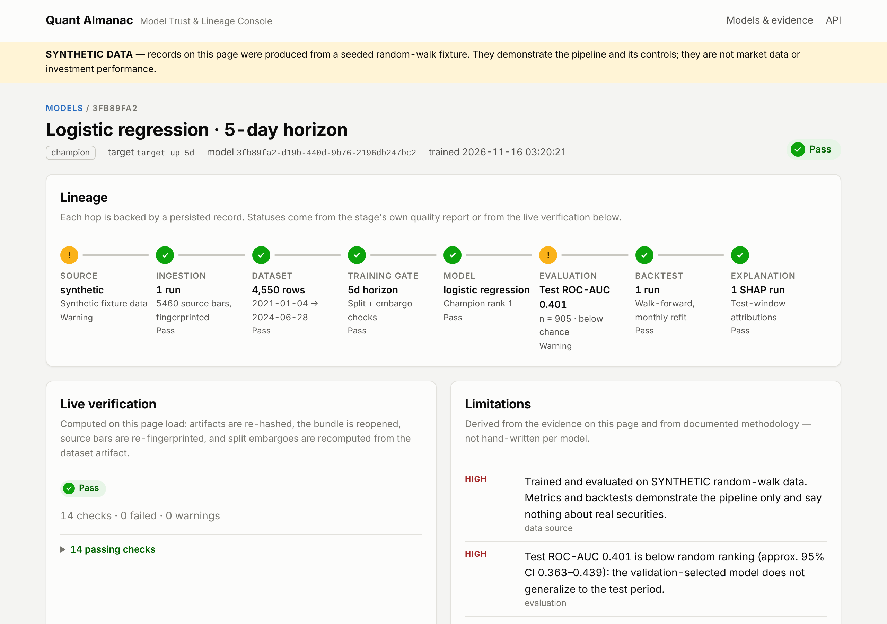
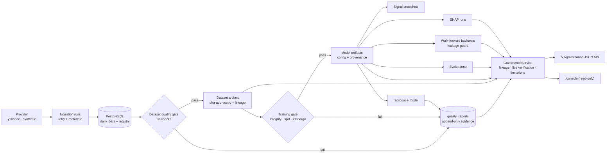

# Quant Almanac

[](https://github.com/co-rtex/quant-almanac/actions/workflows/ci.yml?query=branch%3Amain)
[](LICENSE)

A governed forecasting pipeline for daily US equities. Quant Almanac ingests market data, builds versioned feature datasets, trains calibrated multi-horizon classifiers, runs walk-forward backtests, generates SHAP explanations, and serves ranked signals through FastAPI.

Every stage is gated and traceable. Data-quality checks block bad datasets before training, training gates block leaky splits, every registered artifact (dataset, model, backtest, SHAP) is content-addressed and re-verifiable, and any registered model can be refit from its artifacts to prove it reproduces. A read-only **Model Trust & Lineage Console** shows a reviewer where a model's data came from, which checks it passed, whether its artifacts are intact, and what it cannot claim.



> The screenshots and demo use **synthetic** random-walk data from a seeded generator. They demonstrate the pipeline and its controls. They are not market data or investment performance.

## Why governance

A forecasting pipeline can be technically complete and still untrustworthy. Before this work, the registry recorded artifact hashes, but:

- nothing validated source bars. Duplicate keys, inverted high/low bars, zero prices, and calendar gaps flowed silently into features;
- rebuilding a dataset, retraining a model, or re-running SHAP **overwrote the artifact an older registry row pointed to**, so its recorded SHA-256 no longer matched and training could read different data than its manifest described;
- datasets did not record which ingestion runs they came from, and models did not record hyperparameters, library versions, or code revision;
- nothing checked that labels were aligned to their horizon or that split embargoes actually prevented label overlap;
- CI had failed on every run since the repository was created, because the migration test migrated the CI PostgreSQL database instead of its own SQLite file.

Quant Almanac now answers seven questions for any model, using only persisted evidence:

1. Which source data was used? (ingestion runs, per-symbol bar provenance, source fingerprint)
2. How was that data validated? (persisted dataset quality report)
3. How was the training dataset created and versioned? (content-addressed artifact plus manifest)
4. Which model configuration and evaluation protocol were used? (hyperparameters, split windows, calibration, selection rule)
5. Did the experiment pass its correctness gates? (training-gate report, live verification)
6. What are its limitations? (derived from the evidence, not hand-written)
7. Can it be reproduced? (refit-and-compare report)

## Architecture



| Package | Responsibility |
| --- | --- |
| `quant_signal.quality` | Versioned policy (`dq_v1`), typed check results, bar/dataset/training checks, artifact integrity |
| `quant_signal.governance` | Lineage assembly, live verification, refit-based reproduction, AUC intervals, derived limitations |
| `quant_signal.console` + `api/routes/console.py` | Jinja2 templates, view-model chart geometry, stylesheet |
| `quant_signal.api.routes.governance` | Read-only JSON endpoints with 404s for unknown ids |
| `quant_signal.ingestion.synthetic` | Seeded, window-invariant synthetic provider with documented defect injection |
| `quant_signal.demo` | `quant-almanac-demo`: the reproducible end-to-end demonstration |

The Python package (`quant_signal`), CLI (`quant-signal-pipeline`), and distribution name keep their original identifiers so existing installs and scripts keep working.

**Tech stack:** Python 3.14 · FastAPI and Pydantic · Jinja2 · PostgreSQL, SQLAlchemy, Alembic, and Psycopg · pandas, NumPy, and PyArrow/Parquet · scikit-learn and SHAP · Ruff, strict mypy, pytest, Playwright · Docker Compose and GitHub Actions.

The existing ingestion, feature, training, backtesting, explainability, and serving packages are unchanged in contract. They now call the gates and record lineage. See [ARCHITECTURE.md](ARCHITECTURE.md) for decisions and tradeoffs, and [docs/case-study.md](docs/case-study.md) for the engineering write-up.

## Data-quality checks

Every check records its observed values, thresholds, and up to five offending rows. **Fail** blocks downstream use. **Warn** is recorded and surfaced as a model limitation. Thresholds live in a versioned `DataQualityPolicy` that is persisted with each report.

| Stage | Check | Blocks | Notes |
| --- | --- | --- | --- |
| Source bars | `bars.schema`, `bars.required_values` | yes | Required OHLCV columns; finite values |
| | `bars.duplicate_keys` | yes | One row per (symbol, session) across **all** providers |
| | `bars.session_dates` | yes | Weekday sessions, nothing after the as-of date |
| | `bars.positive_prices`, `bars.ohlc_consistency` | yes | `low ≤ open/close ≤ high` with tolerance |
| | `bars.volume` | negative only | Zero volume warns: trading halts are legitimate. Undefined volume ratios after a halt become missing values, not infinities |
| | `bars.symbol_coverage` | yes | Every requested symbol and the benchmark have bars |
| | `bars.benchmark_calendar` | > 6.5% or long runs | The benchmark defines the calendar, so its own sessions are checked against weekdays. Up to 4.5% missing (exchange holidays) passes |
| | `bars.calendar_alignment` | > 5% gap | Measured inside each symbol's own range, so IPOs and delistings are not penalized |
| | `bars.trailing_coverage`, `bars.extreme_returns`, `bars.stale_prices` | no | Stale feeds, \|return\| > 40%, and frozen prices are flagged for review, not rejected |
| Dataset | `dataset.schema`, `dataset.unique_keys`, `dataset.temporal_bounds`, `dataset.non_finite_features` | yes | Features and labels disjoint; no infinities (they break imputation) |
| | `dataset.label_alignment` | yes | Recomputes every forward return from the artifact's adjusted closes. Catches labels produced by different (e.g. off-by-one) code or edited after the build, and labels in a symbol's final h rows |
| | `dataset.label_calendar_span` | no | Labels are h rows ahead per symbol. Warns when a symbol gap makes a label span more than h benchmark sessions |
| | `dataset.point_in_time_features` | yes | **Look-ahead test.** Recomputes all features from history truncated at three cutoffs and requires identical values |
| | `dataset.feature_target_leakage` | no | \|corr\| ≥ 0.98 with a same-row forward return. This is a heuristic, so it warns. The point-in-time test is the proof |
| | `dataset.feature_missingness`, `dataset.label_availability` | partly | Nulls after the 50-row warmup; labeled rows and both classes per horizon |
| Training | `training.dataset_artifact_integrity` | yes | SHA-256 of the parquet artifact must match the manifest |
| | `training.dataset_quality_gate` | on fail | A legacy dataset with no report trains with a recorded warning |
| | `training.split_ordering`, `training.label_horizon_embargo` | yes | Every train/validation label must be **realized** (per symbol, t+h) before the next split starts |
| | `training.split_class_coverage` | single class | Small splits warn. Every requested horizon is gated before any model is fit |
| Backtest | walk-forward guard | aborts run | Each monthly refit's latest realized label must precede the scored month |
| All consumers | artifact integrity | yes | Backtest, SHAP, and signal publication refuse modified artifacts |

## Experiment lineage

No new source-of-truth tables. Lineage reuses existing records and adds one evidence table:

- **`dataset_versions.metadata_json.lineage`**: source-bar fingerprint (canonical SHA-256 over every bar read), per-symbol × source × ingestion-run counts and date ranges, the ingestion run ids, feature-builder and label definitions, git commit and dirty flag, Python and library versions.
- **`model_versions.metadata_json`**: `training_config` (pipeline steps and scalar hyperparameters, split method and session counts, embargo, calibration, selection rule), `governance` (training and dataset report ids, dataset hash at training time), and `provenance`.
- **`backtest_runs.metadata_json`**: dataset and model hashes at run time, plus walk-forward guard evidence. **SHAP summaries** record the evaluation window, sampling seed, background rows, and hashes.
- **`quality_reports`** (migration `20261116_0002`): append-only evidence for `dataset_build`, `training`, and `reproduction`. This is the only home for evidence about **blocked** builds, which by design have no dataset row.
- **Content-addressed artifacts**: dataset, model, backtest, and SHAP filenames embed their SHA-256 prefix, so an artifact referenced by a registry row is never overwritten.

Historical records are never back-filled. Anything a legacy record did not capture renders as **Unavailable**.

**Live verification** (`verify-model`, `/verification`, and every console page load) re-hashes every artifact, reopens the model bundle and compares it with the registry, re-fingerprints source bars to detect re-ingestion drift, recomputes the label-horizon embargo from the dataset artifact, and checks gate reports, code revision, and runtime versions.

**Reproduction** (`reproduce-model`) rebuilds the split from the immutable dataset artifact, confirms the code still builds the recorded hyperparameters, refits the model family, and compares test predictions and metrics with the registered model. The result is persisted as a `reproduction` report.

## Reproduce the demonstration

Requires Python 3.14. No credentials, Docker, or network data feed are needed: the demo uses SQLite and the synthetic provider.

```bash
python3.14 -m venv .venv && source .venv/bin/activate
pip install -e ".[dev]"
```

```bash
quant-almanac-demo run
```

```bash
quant-almanac-demo serve
```

`run` migrates a fresh database with Alembic and then drives the real `quant-signal-pipeline` CLI. It ingests five synthetic tickers plus `BADQ`, a ticker with documented injected defects. It builds a clean dataset, which passes. It attempts a build that includes `BADQ` and **asserts that the gate blocks it**. It trains 1d/5d/20d candidates, backtests and explains the 5d champion, reproduces it, and verifies it. The run fails if any expected outcome, including the expected failure, does not occur. It writes `demo/demo_summary.json`.

`serve` starts the console on `http://127.0.0.1:8000/console`. It binds to loopback on purpose: the console has no authentication. Do not expose it publicly without adding auth.

| Console view | Screenshot |
| --- | --- |
| Models and quality reports, including the blocked build | [console-index.png](docs/screenshots/console-index.png) |
| Model evidence: lineage, live verification, limitations, gates, evaluation, backtest, SHAP, reproducibility | [console-model.png](docs/screenshots/console-model.png) |
| Blocked dataset build report | [console-blocked-build.png](docs/screenshots/console-blocked-build.png) |

Governance commands work against any deployment:

```bash
quant-signal-pipeline quality-reports --status fail
```

```bash
quant-signal-pipeline verify-model --model-version-id <id>
```

```bash
quant-signal-pipeline reproduce-model --model-version-id <id>
```

`verify-model` and `reproduce-model` exit non-zero on a failing verdict, so they can gate CI or a scheduler. A blocked `build-dataset` exits 1 and its JSON error carries `quality_report_id` and the failed check ids.

### API

| Endpoint | Purpose |
| --- | --- |
| `GET /v1/governance/models` | Models with their stored dataset and training gate status |
| `GET /v1/governance/models/{id}/lineage` | Persisted lineage chain |
| `GET /v1/governance/models/{id}/verification` | Live re-verification (not persisted) |
| `GET /v1/governance/models/{id}/evidence` | Lineage, verification, stage statuses, and limitations |
| `GET /v1/governance/quality-reports?stage=&status=` | Evidence, including blocked builds |
| `GET /v1/governance/quality-reports/{id}` | One report with every check |
| `GET /v1/governance/datasets/{id}/quality` | A dataset manifest and its reports |

Unknown ids return 404. Console responses carry a strict CSP (`default-src 'none'`). Pages contain no JavaScript, and all persisted text is HTML-escaped.

## What has been verified

Commands executed for this change (Python 3.14.6, Linux):

| Check | Result |
| --- | --- |
| `ruff check src tests` | pass |
| `mypy src` (strict) | pass, 68 source files |
| `pytest` | 120 passed (52 pre-existing + 68 new) with Chromium available; without a browser, 118 passed and the 2 browser tests skip with an explicit reason |
| `pytest tests/e2e` (Playwright + Chromium) | 3 passed: index → model → expand evidence → blocked report, phone-width layout, demo summary |
| Alembic `upgrade head → downgrade 20260316_0001 → upgrade head` | pass on SQLite (test) and PostgreSQL 16 (manual) |
| Full governed flow on PostgreSQL 16 | pass build, blocked build, train, backtest guard, SHAP, reproduction `pass`, verification with no failures |
| `quant-almanac-demo run` (SQLite and PostgreSQL 16) | all steps as expected; reproduction max \|Δp\| = 0 on 905 test rows |
| Independent review pass | 13 findings; every confirmed defect fixed with a regression test (see the case study) |

GitHub Actions runs lint, strict typecheck, and the test suite. It then runs the migration round-trip on PostgreSQL 17 (head → previous → base) and the full demo against that PostgreSQL database. A separate Playwright browser job also runs. All of these passed on the pull request that introduced this capability.

What the demo does **not** show: predictive skill. On random-walk data the 5d champion's test ROC-AUC is 0.401 (approx. 95% CI 0.363–0.439), below chance after a regime shift. The console reports this as a high-severity limitation and marks the evaluation stage as a warning, which is the point.

## Limitations

- The console is read-only and unauthenticated. It is meant for local or private-network review.
- Lineage is captured from this change forward. Older registry rows show "Unavailable" and are not back-filled.
- `daily_bars.ingestion_run_id` is last-writer-wins. A dataset records the run ids that were current at build time. Later re-ingestion is detected by the source-fingerprint check rather than preserved row by row.
- The point-in-time test samples three cutoffs. It proves causality for those truncations, not for every date.
- In feature set `ohlcv_v1`, `benchmark_trend` and `benchmark_high_vol` are 0 (not missing) during their 50-session warmup. This is a pre-existing feature quirk, surfaced as a limitation rather than silently changed, because changing it would alter `ohlcv_v1` values.
- Each walk-forward refit leaves its newest ~20% of history unused (the split's test partition plus embargoes). This is safe from leakage but stale: in the demo, the newest label behind a scored month is at least 91 sessions old.
- `train` commits each horizon separately. Gates for every horizon run before any fit, but an unexpected fitting error on a later horizon can still leave earlier horizons persisted.
- The API returns local artifact paths. The console loads model bundles (joblib) only after their hash matches the registry.
- AUC intervals use Hanley–McNeil, which assumes independent observations. Overlapping multi-day labels make the true interval wider, and the console says so.
- Reproduction is exact within one runtime. Library upgrades are flagged by version comparison and may change predictions within numerical tolerance.
- yfinance is a development data source with no production SLA. Backtest costs and slippage default to zero unless configured. Nothing in this repository is investment advice or a performance claim.
- Universe selection is fixed at build time, so survivorship bias is possible. Champion selection uses a single embargoed holdout. Backtests are simplified long-only equal-weight simulations.

## Pipeline CLI reference

```bash
quant-signal-pipeline ingest --start-date 2024-01-02 --end-date 2024-05-31 --symbols AAPL
```

```bash
quant-signal-pipeline build-dataset --as-of-date 2024-05-31 --symbols AAPL
```

```bash
quant-signal-pipeline train --dataset-version-id <dataset-version-id> --horizon 1 --horizon 5
```

```bash
quant-signal-pipeline backtest --model-version-id <model-version-id> --top-n 1 --transaction-cost-bps 5 --slippage-bps 2
```

```bash
quant-signal-pipeline explain --model-version-id <model-version-id> --sample-size 8 --top-signals 3
```

```bash
quant-signal-pipeline publish-signals --model-version-id <model-version-id>
```

Each command delegates to a service (`IngestionService`, `FeaturePipeline`, `TrainingService`, `BacktestService`, `ExplainabilityService`, `GovernanceService`), prints a JSON summary, and emits a compact JSON error with exit code 1 on failure. `train`, `backtest`, `explain`, and `publish-signals` require explicit ids and never infer "latest". `--symbols` defaults to `UNIVERSE_SYMBOLS`.

## Local setup with PostgreSQL

```bash
cp .env.example .env
```

```bash
docker compose up -d postgres
```

```bash
make migrate
```

```bash
make run-api
```

Set `MARKET_DATA_PROVIDER=synthetic` to use the synthetic generator instead of yfinance. Provider retry settings (`MARKET_DATA_MAX_ATTEMPTS`, `MARKET_DATA_BACKOFF_SECONDS`, `MARKET_DATA_BACKOFF_MULTIPLIER`) and backtest cost settings (`BACKTEST_TRANSACTION_COST_BPS`, `BACKTEST_SLIPPAGE_BPS`) are documented in `.env.example`. `make run-api` binds to loopback (127.0.0.1) because the API and console have no authentication. Put authentication in front of them before binding to a network interface.

## Validation workflow

- `make lint`, `make typecheck`, `make test`, `make validate`
- `make install-e2e` then `make e2e` for browser tests (or set `PLAYWRIGHT_CHROMIUM_EXECUTABLE`)
- `make demo` and `make demo-console`

## Repository layout

```text
.
├── alembic/                  # Database migrations (0001 initial, 0002 quality_reports)
├── docs/                     # Case study and real console screenshots
├── src/quant_signal/
│   ├── quality/              # Data-quality policy, checks, gates, artifact integrity
│   ├── governance/           # Lineage, verification, reproduction, limitations
│   ├── console/              # Templates, static CSS, view helpers
│   └── ...                   # ingestion, features, training, backtesting, explainability, api, cli
├── tests/                    # unit, integration, e2e (Playwright)
├── ARCHITECTURE.md · CHANGELOG.md · EXECUTION_PLAN.md · LICENSE
└── Makefile · docker-compose.yml · pyproject.toml
```

## License

[MIT](LICENSE) © 2026 Christian Cortez
